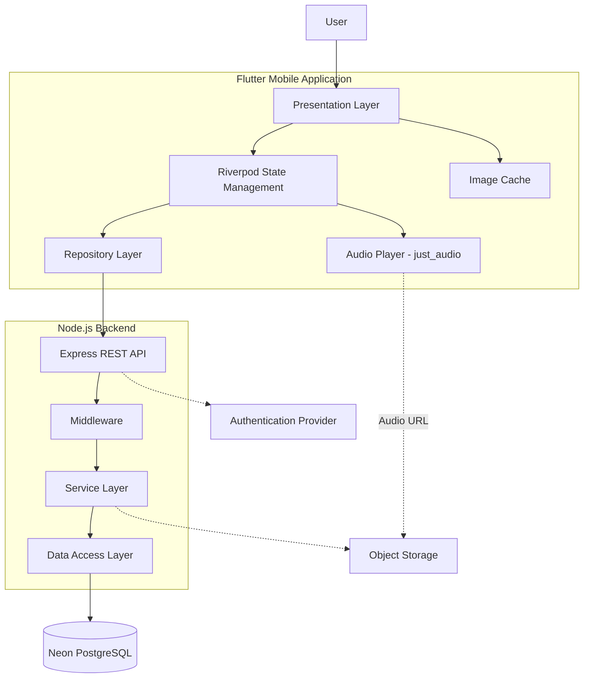
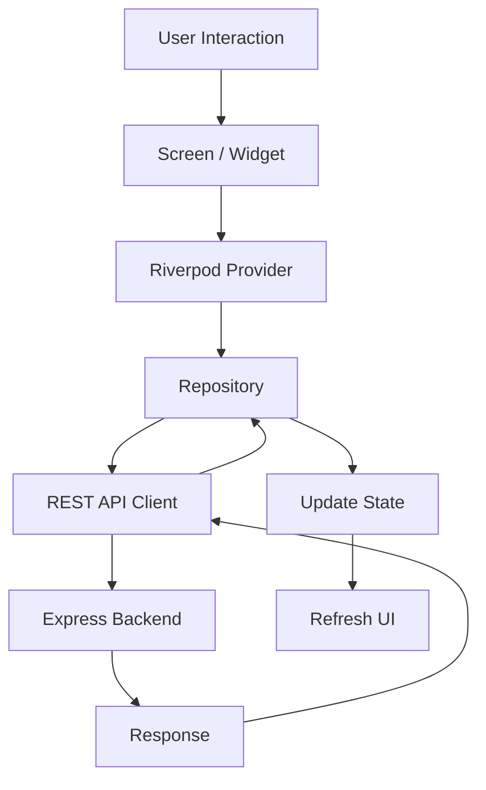
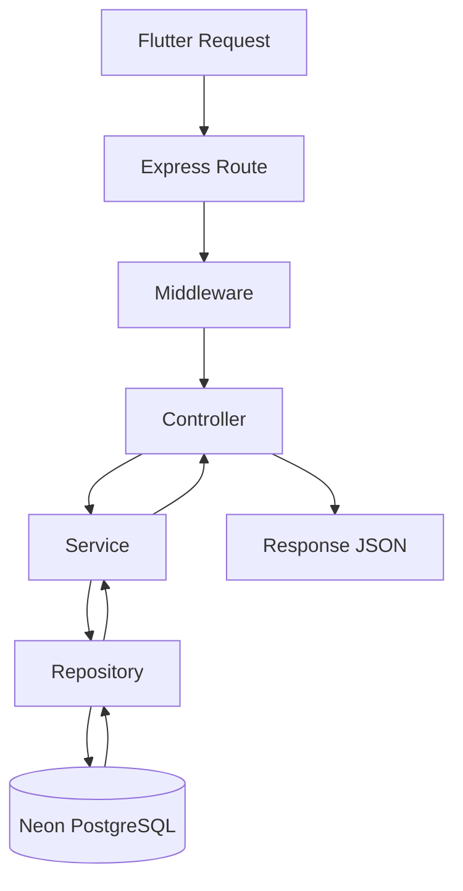
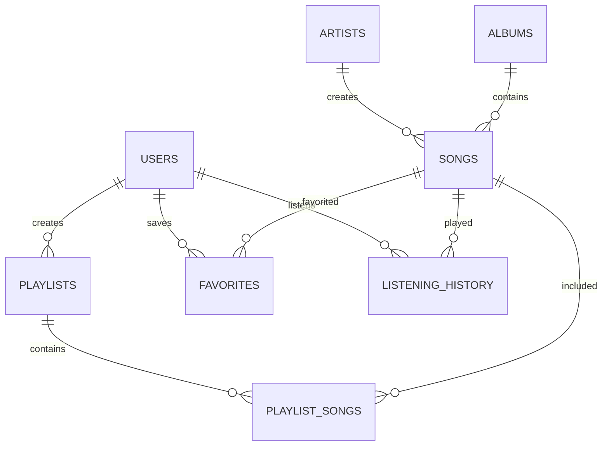

# ARCHITECTURE.md — SoundShare

> **Cập nhật V3 (06/11/2026):** các mục “chưa chọn provider/backend mục tiêu” bên dưới là tài liệu kiến trúc ban đầu. Source hiện dùng Clerk, Express REST, Neon và Cloudinary authenticated. Module community gồm route/controller/service/repository riêng, schema 004 và DTO không lộ identity riêng tư. Flutter feature `community` dùng Riverpod/GoRouter hiện có và cùng AudioPlayer; không nối Neon trực tiếp. Hợp đồng hiện hành ở [PRD V3](PRD.md#v3--nocturne-hợp-đồng-cộng-đồng), [kiểm kê](docs/ui/nocturne-v3-audit.md) và [vận hành](docs/nocturne-v3.md).

> Tài liệu mô tả kiến trúc tổng thể của SoundShare, trách nhiệm của từng thành phần, luồng dữ liệu và nguyên tắc tổ chức source code.
>
> **Trạng thái:** Architecture đề xuất cho hệ thống mục tiêu. Những thành phần chưa được triển khai hoặc xác minh phải được đánh dấu tương ứng.

---

## 1. Tổng quan hệ thống

SoundShare là ứng dụng chia sẻ và nghe nhạc, gồm hai phần chính:

- **Mobile Application:** Flutter, cung cấp giao diện và trải nghiệm nghe nhạc cho người dùng.
- **Backend API:** Node.js + Express, xử lý nghiệp vụ và giao tiếp với cơ sở dữ liệu.
- **Database:** Neon PostgreSQL, lưu trữ dữ liệu có cấu trúc.
- **Authentication Provider:** Nhà cung cấp xác thực độc lập, chưa được lựa chọn.
- **Object Storage:** Dịch vụ lưu trữ file audio và ảnh bìa, chưa được lựa chọn.

### Công nghệ sử dụng

| Thành phần       | Công nghệ            | Trạng thái         |
| ---------------- | -------------------- | ------------------ |
| Mobile           | Flutter / Dart       | Đã có source code  |
| UI               | Material 3           | Đã có source code  |
| State management | Riverpod             | Đã có trong stack  |
| Navigation       | GoRouter             | Đã có trong stack  |
| Audio playback   | just_audio           | Đã có trong stack  |
| Image caching    | cached_network_image | Đã có trong stack  |
| Backend          | Node.js + Express    | Kiến trúc mục tiêu |
| Database         | Neon PostgreSQL      | Kiến trúc mục tiêu |
| Authentication   | Chưa lựa chọn        | Pending            |
| File storage     | Chưa lựa chọn        | Pending            |

---

## 2. Kiến trúc tổng thể

SoundShare sử dụng kiến trúc Client–Server.



**Nguyên tắc:**

1. Flutter không kết nối trực tiếp tới Neon PostgreSQL.
2. Mọi thao tác dữ liệu nghiệp vụ đi qua Backend API.
3. Backend chịu trách nhiệm xác thực, kiểm tra dữ liệu và xử lý nghiệp vụ.
4. Neon chỉ lưu trữ dữ liệu có cấu trúc, không dùng để lưu trực tiếp file nhạc.
5. Audio và artwork được lưu tại Object Storage; database lưu URL hoặc storage key.
6. Không đưa database credentials, API secrets hoặc private keys vào Flutter app.

---

## 3. Flutter Application Architecture

Flutter được tổ chức theo hướng Feature-based Architecture.

Mỗi tính năng có thể chia thành các lớp:

- **Presentation:** Screens, widgets và UI components.
- **Domain:** Models, entities và business rules.
- **Data:** Repository implementations và API data sources.

### Cấu trúc thư mục đề xuất

```text
lib/
├── app/
│   ├── router/
│   └── theme/
│
├── core/
│   ├── constants/
│   ├── network/
│   ├── errors/
│   ├── utils/
│   └── widgets/
│
├── features/
│   ├── home/
│   │   ├── data/
│   │   ├── domain/
│   │   └── presentation/
│   │
│   ├── explore/
│   ├── player/
│   ├── upload/
│   ├── library/
│   └── profile/
│
└── main.dart
```

Đây là cấu trúc mục tiêu; không tự ý di chuyển hoặc đổi tên các thư mục hiện tại nếu chưa kiểm tra source code và đánh giá ảnh hưởng.

### Trách nhiệm các lớp

| Layer            | Trách nhiệm                           |
| ---------------- | ------------------------------------- |
| Presentation     | Hiển thị UI, nhận thao tác người dùng |
| State Management | Quản lý trạng thái bằng Riverpod      |
| Domain           | Định nghĩa model và nghiệp vụ         |
| Repository       | Cung cấp interface truy cập dữ liệu   |
| Data Source      | Gọi REST API hoặc nguồn dữ liệu khác  |

### Luồng dữ liệu Flutter



**Quy tắc:**

- Không gọi HTTP trực tiếp trong Widget.
- Không đặt business logic phức tạp trong Screen.
- Tách API calls khỏi UI.
- Sử dụng Riverpod để quản lý loading, success và error states.
- Không tạo provider hoặc repository trùng chức năng.
- Giữ nguyên các quy ước đang có trong project nếu chưa có yêu cầu thay đổi.

---

## 4. Backend Architecture

Backend sử dụng Node.js + Express, thiết kế theo các lớp:

```text
backend/
├── src/
│   ├── config/
│   │   ├── database.js
│   │   └── env.js
│   │
│   ├── routes/
│   ├── controllers/
│   ├── services/
│   ├── repositories/
│   ├── middleware/
│   ├── validators/
│   ├── utils/
│   └── app.js
│
├── migrations/
├── tests/
├── server.js
├── package.json
└── .env.example
```

Đây là cấu trúc đề xuất, chưa khẳng định backend đã tồn tại trong repository.

### Trách nhiệm từng lớp

| Layer        | Trách nhiệm                                   |
| ------------ | --------------------------------------------- |
| Routes       | Khai báo API endpoints                        |
| Middleware   | Authentication, authorization, error handling |
| Controllers  | Nhận request và trả response                  |
| Services     | Xử lý business logic                          |
| Repositories | Truy vấn và thao tác database                 |
| Validators   | Kiểm tra dữ liệu đầu vào                      |
| Config       | Cấu hình database và môi trường               |

### Request flow



**Quy tắc Backend:**

- Controller không chứa truy vấn SQL phức tạp.
- Business logic nằm trong Service.
- Database queries nằm trong Repository.
- Validate request trước khi xử lý.
- Sử dụng parameterized queries để tránh SQL injection.
- Xử lý lỗi tập trung bằng error-handling middleware.
- Không trả về thông tin nhạy cảm trong API response.

---

## 5. Database Architecture — Neon PostgreSQL

Neon là PostgreSQL database được sử dụng để lưu dữ liệu nghiệp vụ.

### Các nhóm dữ liệu dự kiến

| Table             | Mục đích                    |
| ----------------- | --------------------------- |
| users             | Thông tin hồ sơ người dùng  |
| songs             | Thông tin bài hát           |
| artists           | Thông tin nghệ sĩ           |
| albums            | Thông tin album             |
| playlists         | Danh sách phát              |
| playlist_songs    | Quan hệ playlist và bài hát |
| favorites         | Bài hát yêu thích           |
| listening_history | Lịch sử nghe nhạc           |

Đây là schema định hướng. Cần thống nhất với PRD trước khi tạo migrations chính thức.

### Quan hệ dữ liệu dự kiến



### Database rules

- Sử dụng UUID hoặc ID nhất quán cho primary keys.
- Khai báo foreign keys cho các quan hệ.
- Tạo indexes cho các trường thường xuyên truy vấn.
- Sử dụng migrations để quản lý thay đổi schema.
- Lưu timestamp cho các dữ liệu cần theo dõi thời gian.
- Không lưu file audio trực tiếp trong PostgreSQL.
- Không lưu plaintext password.

---

## 6. Audio và Image Storage

Neon không phải dịch vụ lưu trữ file audio hoặc artwork.

Kiến trúc mục tiêu:

```text
Flutter App
    |
    | Request song metadata
    v
Express API
    |
    v
Neon PostgreSQL
    |
    | Return audio_url / artwork_url
    v
Flutter App
    |
    | Load audio stream
    v
Object Storage / CDN
```

Database lưu metadata và đường dẫn file, ví dụ:

- `audio_url`
- `artwork_url`
- `duration`
- `file_size`
- `mime_type`

Không hardcode URL giả định vào production. Storage provider và chính sách truy cập file phải được quyết định trước khi triển khai upload thực tế.

---

## 7. Authentication và Authorization

Authentication provider hiện chưa được lựa chọn.

Kiến trúc mục tiêu:

1. Người dùng đăng nhập qua Authentication Provider.
2. Client nhận access token.
3. Flutter gửi token trong Authorization header.
4. Express middleware xác minh token.
5. Backend xác định user tương ứng.
6. Service kiểm tra quyền trước khi truy cập hoặc thay đổi dữ liệu.

Ví dụ:

```http
Authorization: Bearer <access_token>
```

Không tin tưởng `user_id` do client tự gửi để xác định quyền sở hữu dữ liệu.

---

## 8. API Architecture

Backend cung cấp REST API với prefix:

```text
/api/v1
```

### API endpoints dự kiến

| Method | Endpoint                     | Chức năng              |
| ------ | ---------------------------- | ---------------------- |
| GET    | /api/v1/songs                | Lấy danh sách bài hát  |
| GET    | /api/v1/songs/:id            | Chi tiết bài hát       |
| GET    | /api/v1/artists              | Danh sách nghệ sĩ      |
| GET    | /api/v1/albums               | Danh sách album        |
| GET    | /api/v1/playlists            | Danh sách playlist     |
| POST   | /api/v1/playlists            | Tạo playlist           |
| GET    | /api/v1/me/favorites         | Lấy bài hát yêu thích  |
| POST   | /api/v1/me/favorites         | Thêm bài hát yêu thích |
| DELETE | /api/v1/me/favorites/:songId | Xóa bài hát yêu thích  |
| GET    | /api/v1/me/history           | Lịch sử nghe           |
| POST   | /api/v1/me/history           | Ghi nhận lượt nghe     |

Danh sách trên là thiết kế ban đầu, cần điều chỉnh theo PRD và nghiệp vụ thực tế.

### Response format đề xuất

Success:

```json
{
  "success": true,
  "data": {},
  "message": "Request successful"
}
```

Error:

```json
{
  "success": false,
  "error": {
    "code": "VALIDATION_ERROR",
    "message": "Invalid request"
  }
}
```

---

## 9. Security Architecture

Các nguyên tắc bảo mật bắt buộc:

- Không commit `.env` lên Git.
- Có `.env.example` nhưng không chứa secrets.
- Database chỉ được truy cập từ Backend.
- Dùng environment variables cho credentials.
- Validate và sanitize dữ liệu đầu vào.
- Xác minh access token ở Backend.
- Kiểm tra quyền sở hữu playlist, upload và dữ liệu cá nhân.
- Giới hạn kích thước và loại file upload.
- Không trả database errors hoặc stack traces cho client trong production.
- Sử dụng HTTPS khi triển khai.

---

## 10. Deployment Architecture

Kiến trúc triển khai mục tiêu:

```text
Flutter Application
       |
       | HTTPS
       v
Backend Hosting
(Node.js + Express)
       |
       +------> Neon PostgreSQL
       |
       +------> Authentication Provider
       |
       +------> Object Storage / CDN
```

Flutter app được build và phát hành riêng. Backend và database được triển khai độc lập.

Nhà cung cấp hosting, storage và authentication sẽ được bổ sung sau khi có quyết định chính thức.

---

## 11. Nguyên tắc dành cho AI Contributor

Khi AI thực hiện thay đổi trong SoundShare:

1. Đọc `README.md`, `PRD.md`, `DESIGN.md`, `AGENTS.md` và `TASKS.md` trước khi triển khai task liên quan.
2. Đọc source code hiện tại trước khi tạo file hoặc thay đổi kiến trúc.
3. Không giả định backend, Neon, authentication hoặc storage đã được tích hợp nếu chưa có bằng chứng trong source code.
4. Không kết nối Flutter trực tiếp với Neon.
5. Không đặt SQL queries trong Flutter.
6. Không đặt business logic vào UI widgets.
7. Không tự ý thay đổi kiến trúc hoặc thêm dependency nếu không cần thiết.
8. Ưu tiên tái sử dụng components, providers và repositories hiện có.
9. Khi thêm API, phải cập nhật tài liệu endpoint và xử lý loading/error states.
10. Khi thay đổi database schema, phải tạo hoặc cập nhật migration.
11. Khi hoàn thành task, cập nhật `TASKS.md`.
12. Nếu kiến trúc thực tế khác tài liệu này, kiểm tra source code và đề xuất cập nhật tài liệu thay vì tự suy đoán.

---

## 12. Architecture Decision Records

Các quyết định hiện tại:

| ID      | Decision                                  | Status         |
| ------- | ----------------------------------------- | -------------- |
| ADR-001 | Flutter làm mobile application            | Adopted        |
| ADR-002 | Riverpod quản lý state                    | Existing stack |
| ADR-003 | GoRouter quản lý navigation               | Existing stack |
| ADR-004 | Node.js + Express làm Backend             | Proposed       |
| ADR-005 | Neon PostgreSQL làm Database              | Proposed       |
| ADR-006 | Flutter không truy cập database trực tiếp | Required       |
| ADR-007 | Authentication provider                   | Pending        |
| ADR-008 | Object storage provider                   | Pending        |

Mọi thay đổi lớn về công nghệ hoặc kiến trúc cần được ghi nhận tại đây.

---

## 13. Cập nhật tài liệu

Khi hệ thống thay đổi:

- Cập nhật architecture diagram.
- Cập nhật folder structure nếu có thay đổi.
- Cập nhật API và database architecture.
- Cập nhật ADR nếu có quyết định công nghệ mới.
- Đồng bộ nội dung với `PRD.md`, `AGENTS.md` và `TASKS.md`.

**Nguyên tắc cuối cùng:** Tài liệu phải phản ánh kiến trúc thực tế của repository, không chỉ phản ánh kiến trúc dự kiến.
