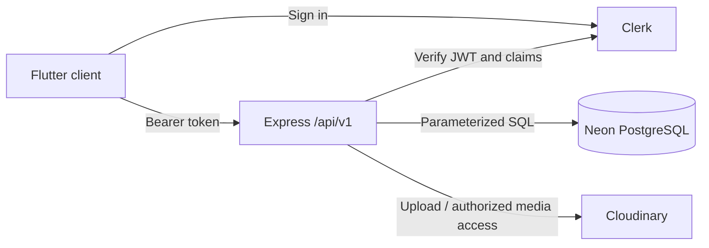

# SoundShare architecture

This document describes the source included in v1.2.0. For endpoint schemas and permissions, see [PRD.md](PRD.md); operational and device acceptance limits live in the [feature guides](README.md#documentation).

## Components

| Component | Responsibility |
| --- | --- |
| Flutter / Dart | Responsive UI, local appearance preferences, playback, and authenticated API calls |
| Riverpod / GoRouter | Feature state, session boundaries, and navigation |
| just_audio / audio_service | Shared audio engine and Android media controls |
| Express REST API | Validation, token verification, authorization, and orchestration under `/api/v1` |
| Clerk | Sign-in, session management, and signed identity tokens |
| Neon PostgreSQL | Application metadata, social relationships, lyrics, and durable job state |
| Cloudinary | Authenticated audio and artwork storage |

The client never connects directly to Neon. Database and storage credentials are backend-only. The Web config helper uses an explicit allowlist of public values; it does not serialize the backend environment.

## Source layout

- `lib/app/`: routing, themes, and application composition.
- `lib/core/`: API transport, playback, upload transport, shared widgets, and configuration.
- `lib/features/`: authentication, community, discovery, uploads, library, player, lyrics, Shorts, and notifications.
- `lib/l10n/`: Vietnamese copy and generated Flutter localization.
- `backend/src/`: routes, controllers, services, repositories, middleware, validation, and migrations.
- `backend/scripts/`: operator moderation command.
- `backend/notification-worker.js`: scheduled notification delivery and expired snapshot cleanup.
- `web/`: Web entry points, Clerk bridge, theme bootstrap, and upload transport.
- `test/` and `backend/test/`: automated tests, fixtures, and mocked providers.

## Identity and authorization

Clerk handles authentication. Flutter sends a Bearer token to Express; the server verifies the signature, trusted issuer, audience, expiry, and configured authorized parties. It uses the verified subject to find the application profile, rather than trusting client-supplied user IDs or ownership claims.

Repositories and services enforce ownership, visibility, active track status, and profile availability. Private resources are not exposed through public discovery or another user's requests. API errors use safe messages and request IDs, and logs omit tokens, connection strings, and provider responses.

## Upload and media lifecycle

The current implementation accepts validated multipart uploads through Express. The backend checks type, signature, and size before storing audio/artwork in Cloudinary, then returns an owned asset ID. Track creation references those IDs, rechecks ownership, and persists metadata in Neon. MP3 uploads are limited to 20 MB; artwork to 5 MB.

Tracks start private. Public sharing requires an application username and confirmation of sharing rights. Playback resolves authorized media URLs after checking current visibility. Signed URLs are transient and are not permanent catalog identifiers.

Retrying metadata creation reuses the uploaded asset IDs and avoids duplicate tracks. Deletion removes application relationships and records durable storage cleanup work; failed storage cleanup can retry. Operator moderation remains a backend CLI action, not a client-controlled permission.

## Playback and lyrics

Navigation, Shorts, queues, and lyrics use the same audio engine and playback actions. Closing a sheet or opening fullscreen lyrics does not create another player. Session changes stop playback and release account-specific state.

Android integrates media controls and background playback through `audio_service`; device behavior still requires native acceptance testing. UI animations and position subscriptions respect lifecycle and reduced motion.

LRC text is bounded application content, separate from audio/artwork. Node and Dart validate the supported timestamp format using shared fixtures. Lyrics read permissions follow the track, while only its uploader can write. Revision checks prevent stale edits; track creation with lyrics is atomic. See [the lyrics contract](docs/soundshare-v11-lyrics.md).

## Social data and background work

Recommendations use bounded queries and a deterministic scoring service, not an external AI provider. Shorts, comments, replies, and notifications enforce the same visibility boundary as full tracks.

The notification outbox and media cleanup queues persist in PostgreSQL. In-process timers process work while the server is running; the notification worker can run from an external scheduler. A sleeping service pauses local timers. The optional 14-minute self-ping cannot wake a suspended process or replace a reliable scheduler.

## Schema and deployment

Versioned migrations live in `backend/src/database/migrations/` and currently run through **007**. The migration runner uses a lock, tracks applied filenames, and executes each migration transactionally. Server startup checks readiness and never migrates implicitly.

Docker builds Flutter Web and serves it with Express on one origin. `WEB_API_BASE_URL` can remain empty for this arrangement. Runtime secrets stay outside the image. The [Render guide](docs/render-safari-deploy.md) covers deployment configuration and health checks.

## Tests and verification

Flutter tests cover navigation, responsive layouts, playback, uploads, and feature state. Web JavaScript tests cover the browser bridges. Backend tests use isolated PGlite/PostgreSQL fixtures, signed test tokens, and mocked storage. A separate optional TCP PostgreSQL test requires a dedicated test database.

Provider smoke checks are opt-in operational checks, distinct from the default test suite. Do not run test fixtures or destructive operations against a production database. Automated tests do not certify Safari or native background behavior; consult the feature-specific device checklists.

Historical design audits, browser review generators, and screenshots are indexed in [the development archive](docs/archive.md).
