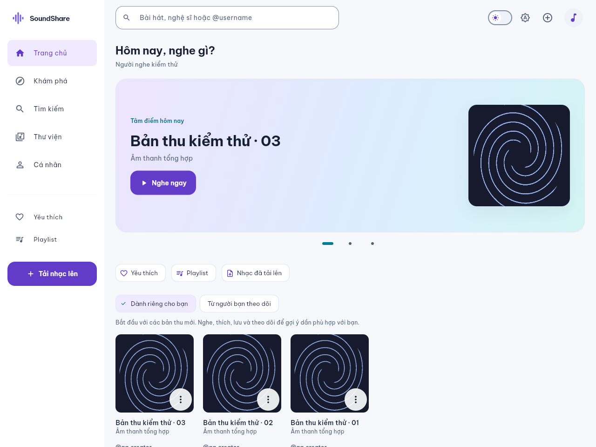
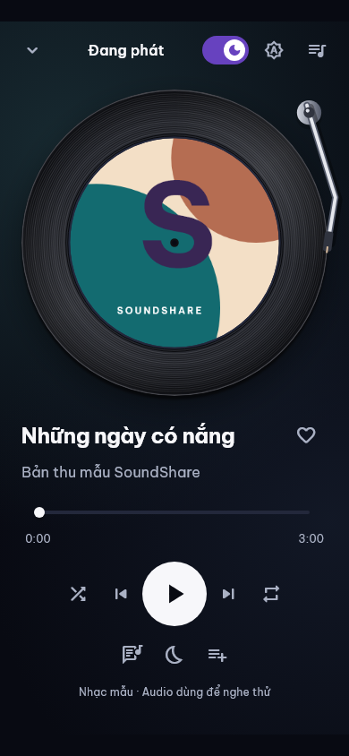
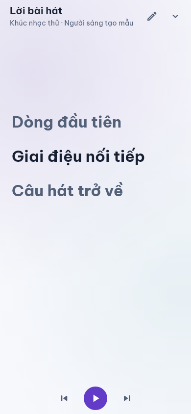
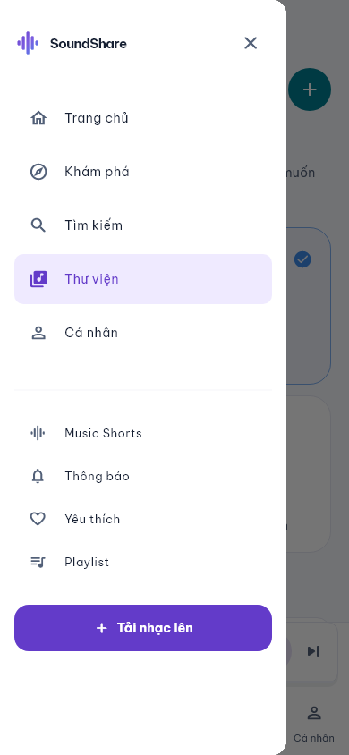
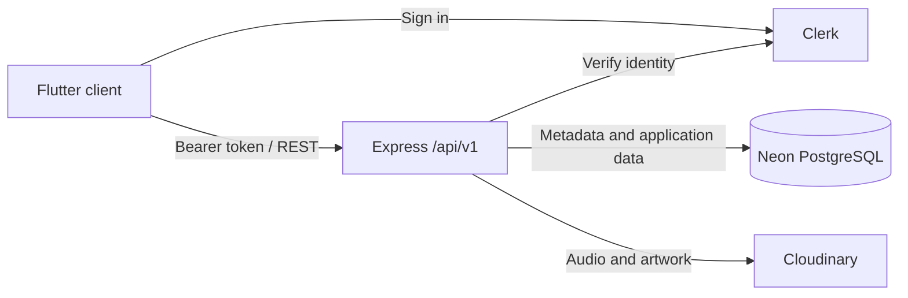

<p align="center">
  
</p>

<h1 align="center">SoundShare</h1>

<p align="center">Share your music. Discover independent creators. Keep listening.</p>

<p align="center">
  <a href="https://github.com/TieuBao-IT89/SoundShare/releases"></a>
  <a href="LICENSE"></a>
  
  
</p>

<p align="center">
  <a href="https://soundshare-783s.onrender.com">Hosted preview</a> ·
  <a href="#getting-started">Getting started</a> ·
  <a href="#documentation">Documentation</a> ·
  <a href="CONTRIBUTING.md">Contributing</a> ·
  <a href="CHANGELOG.md">Changelog</a>
</p>

SoundShare is an open source music sharing app built with Flutter and an Express REST API. Upload your own recordings, discover creators, build playlists, and listen with a vinyl player and synchronized lyrics. The interface is currently in Vietnamese, with responsive layouts and light, dark, and system appearance modes.

The hosted preview requires an account for community features. It runs on a free Render instance, so the first request can take a moment to load.



## Features

- **Discover music:** search recordings, creators, and playlists; browse genres, trending tracks, and recommendations based on listening activity.
- **A shared player:** vinyl artwork, ambient colors, queue reordering, shuffle, repeat, favorites, and a sleep timer across navigation.
- **Synced lyrics:** attach UTF-8 LRC files, edit your own lyrics, follow the current line, tap to seek, and open a fullscreen view.
- **Music Shorts:** browse short previews with the same playback engine, creator links, comments, replies, and likes.
- **Community:** public profiles, follows, public/private playlists, and an in-app notification inbox with preferences.
- **Creator uploads:** MP3 recordings up to 20 MB and artwork up to 5 MB; uploads are private by default and validated by the server.
- **Accessible layouts:** phone and desktop navigation, keyboard search, scalable text, reduced motion, and saved appearance preferences.

## Screenshots

<table>
  <tr><th>Vinyl player</th><th>Synced lyrics</th><th>Mobile navigation</th></tr>
  <tr>
    <td></td>
    <td></td>
    <td></td>
  </tr>
</table>

Screenshots use sample recordings, artwork, and test accounts. They illustrate the interface rather than production activity or native device certification.

## Getting started

### Requirements

- Flutter **3.47.4** with Dart **3.13.3** or a compatible SDK. The Docker build pins this Flutter release.
- Node.js **22** and npm for the backend.
- Chrome for local Web development.
- For account-backed development: separate development instances of Clerk, Neon PostgreSQL, and Cloudinary.

### Explore the UI without a backend

```sh
git clone https://github.com/TieuBao-IT89/SoundShare.git
cd SoundShare
flutter pub get --enforce-lockfile
flutter run -d chrome --dart-define=DEMO_MODE=true
```

Demo mode uses sample data. Uploads, community mutations, and persistence require the configured backend.

### Run the full app

**1. Install dependencies and prepare backend configuration.**

```sh
flutter pub get --enforce-lockfile
npm --prefix backend ci
cp backend/.env.example backend/.env
```

Fill in `backend/.env` using your own development services:

| Configuration | Purpose |
| --- | --- |
| `DATABASE_URL` | Backend-only Neon PostgreSQL connection with TLS |
| `CLERK_PUBLISHABLE_KEY`, `CLERK_SECRET_KEY` | Keys from the same Clerk instance |
| `CLERK_AUDIENCE` | Expected token audience; defaults to `soundshare-api` |
| `CLERK_AUTHORIZED_PARTIES` | Local browser origin, such as `http://localhost:3000` |
| `CLOUDINARY_CLOUD_NAME`, `CLOUDINARY_API_KEY`, `CLOUDINARY_API_SECRET` | Backend storage configuration |

In Clerk's session token customization, include the claim `{"aud":"soundshare-api"}`. Keep `NODE_ENV=development` locally. Leave `WEB_API_BASE_URL` empty when Express serves both Web and API.

**2. Prepare the development database.**

```sh
npm --prefix backend run migrate
npm --prefix backend run db:check
```

The current schema includes migrations **001–007**. Review migrations before applying them to an existing deployment. Startup checks readiness and never applies migrations automatically.

**3. Build the Web client and start Express.**

On PowerShell, the helper prepares public client configuration, checks the schema, builds Web, and starts the backend:

```powershell
.\scripts\run-web.ps1
```

On macOS/Linux:

```sh
node scripts/prepare-web-config.mjs
flutter build web --release --no-web-resources-cdn --dart-define-from-file=.local/web-config.json
SERVE_FLUTTER_WEB=true npm --prefix backend start
```

Open **http://localhost:3000**. The config helper exports only the public Clerk key, API origin, and app mode; database credentials and provider secrets stay in the backend. Never copy `backend/.env` into a Flutter build.

## Architecture



Flutter uses Riverpod, GoRouter, and a shared audio player. Express separates routes, validation, services, and repositories, checks resource ownership and visibility, and issues authorized media URLs. The client never connects directly to Neon.

```text
lib/          Flutter features, shared services, widgets, and localization
backend/      Express API, migrations, operational tools, and backend tests
web/          Web entry points and Clerk integration
test/         Flutter tests, fixtures, and Web JavaScript tests
scripts/      Local Web configuration and startup helpers
docs/         Feature guides, deployment notes, and selected screenshots
```

See [ARCHITECTURE.md](ARCHITECTURE.md) for component responsibilities and data flows.

## Testing

```sh
dart format --output=none --set-exit-if-changed lib test
flutter analyze
flutter test
npm --prefix backend test
node --test test/web/*.cjs
```

Backend integration tests use isolated PostgreSQL/PGlite fixtures and mocked providers. The optional TCP PostgreSQL test requires a dedicated `TEST_DATABASE_URL`; never point it at a production database. The provider smoke check is a separate opt-in operation described in [the account setup guide](docs/auth-real-data.md).

## Deployment and platform status

| Platform | Status |
| --- | --- |
| Web | Hosted preview available; primary development and validation target |
| Android | Background audio and MediaSession integration in source; device acceptance testing remains |
| iOS / Windows | Project files included; native releases have not been validated |

The [Render guide](docs/render-safari-deploy.md) covers Docker, environment variables, schema readiness, proxy configuration, and Safari checks. Blueprint follows `develop` and leaves auto-deploy disabled. A release tag does not deploy a service or configure external schedulers.

The optional 14-minute self-ping only runs while the process is alive; it cannot wake a suspended process. Notification outbox recovery also needs a reliable scheduler for continuous delivery. See the deployment guide for these limits. Native device checks and Safari iPhone acceptance remain separate from automated tests.

## Documentation

| Guide | Contents |
| --- | --- |
| [Architecture](ARCHITECTURE.md) | Components, boundaries, storage, and authentication |
| [Design system](DESIGN.md) | Themes, typography, responsive layouts, and accessibility |
| [Product and API contract](PRD.md) | Features, endpoints, permissions, and validation |
| [Account-backed setup](docs/auth-real-data.md) | Authentication, uploads, and provider smoke checks |
| [Community](docs/nocturne-v3.md) | Profiles, visibility, playlists, and moderation |
| [Recommendations](docs/personalized-recommendations.md) | Ranking inputs and algorithm limits |
| [Background audio](docs/soundshare-v7-background-audio.md) | Android playback integration and device checklist |
| [Social music](docs/soundshare-v9-social-music.md) | Shorts, comments, and notifications |
| [Synced lyrics](docs/soundshare-v11-lyrics.md) | LRC format, editing, revisions, and migration 007 |
| [Render deployment](docs/render-safari-deploy.md) | Hosting and operational configuration |

Most detailed product and operational guides are currently in Vietnamese. Historical QA reports and one-off scripts remain accessible through the [development archive](docs/archive.md).

## Contributing

Bug reports, focused pull requests, documentation improvements, and accessibility fixes are welcome. Start with [CONTRIBUTING.md](CONTRIBUTING.md), follow the [Code of Conduct](CODE_OF_CONDUCT.md), and use [GitHub Issues](https://github.com/TieuBao-IT89/SoundShare/issues) for reproducible bugs and feature proposals.

Report vulnerabilities privately as described in [SECURITY.md](SECURITY.md). Do not include credentials or personal data in issues, screenshots, or logs.

## License

SoundShare source code is licensed under the [MIT License](LICENSE). The bundled Be Vietnam Pro font has its own [OFL license](assets/fonts/OFL.txt); vendored Clerk localization includes its [upstream license](web/clerk-localization-LICENSE.txt). Uploaded music and artwork remain subject to their respective owners' rights.
