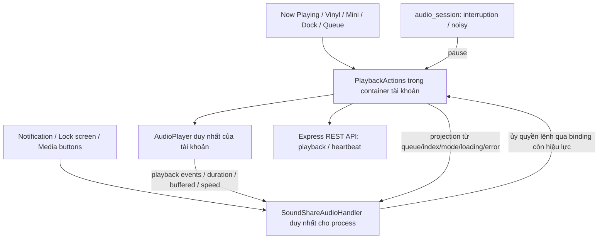

# SoundShare V7 — Native Audio Experience

Trạng thái: đã triển khai source và kiểm thử tự động; **chưa nghiệm thu Android trên thiết bị/emulator**. Máy làm việc có Flutter 3.47.4 / Dart 3.13.3, chưa có Android SDK. V7 nằm trên nhánh `feature/native-android-audio-v7`, bắt đầu từ `develop` tại `c3b5100` (bản 1.1.0). Không chạy migration, không commit/push trong nhiệm vụ V7.

## 1. Audit và lựa chọn

Trước V7, `audioPlayerProvider` tạo player trong container tài khoản. `PlaybackActions` sở hữu hàng đợi, lựa chọn bài, request/source generation, signed playback URL, completion, ticket và heartbeat 15 giây. UI đọc cùng player qua Riverpod. `SessionScope` tạo container riêng, xác minh `/auth/me`, dispose khi phiên bị thay thế. Manifest chỉ có Internet, `MainActivity` là FlutterActivity; chưa có Android media service.

Giữ `just_audio ^0.9.46`, thêm `audio_service ^0.18.19`, khai báo trực tiếp `audio_session ^0.1.25` và `path_provider ^2.1.6` vốn đã có trong lockfile. Không nâng các package khác lên major mới. `audio_service` phù hợp vì có handler nhận lệnh hệ thống, queue và playback state projection; [tài liệu package](https://pub.dev/packages/audio_service) mô tả việc bọc audio code hiện có. Không dùng thêm `just_audio_background`; [package đó](https://pub.dev/packages/just_audio_background) hướng tới cách tích hợp đơn giản hơn và cũng dựa trên audio_service.

## 2. Quyền sở hữu và luồng lệnh



- `NativeAudioRuntime.initialize()` chạy một lần trước `runApp`, chỉ khi Android native. Khởi tạo handler rỗng không tự chọn bài hoặc phát nhạc. Web và nền tảng khác bỏ qua native service.
- `audioPlayerProvider` vẫn tạo/dispose player; factory có đúng một chỗ gọi `AudioPlayer(...)`. Handler **không** tạo player. Mọi widget dùng instance này như trước.
- `playbackActionsProvider` gắn player cùng các callback vào handler. Handler không giữ `Ref` và không có thuật toán queue/shuffle/completion/heartbeat riêng. Queue công bố là projection, không nhận cập nhật queue tùy ý từ controller bên ngoài.
- Khi container dispose, actions đánh dấu không còn hiệu lực, thu hồi binding và hủy listener/heartbeat/completion/focus; metadata/queue hệ thống được xóa. Provider của player gọi dispose thật. Tài khoản mới chờ engine và audio focus của phiên cũ dọn xong trước khi tải decoder; lỗi retirement chặn tải mới thay vì phát chồng. Facade Dart mới có thể được tạo ở trạng thái idle trong lúc chờ native teardown.
- Binding có identity riêng; callback, ảnh tải muộn hoặc detach của phiên cũ không ghi vào binding mới. Các action đã được giữ ở nơi khác kiểm tra `_disposed` trước khi đọc Ref.

## 3. State và điều khiển media

Handler triển khai `play`, `pause`, `stop`, `seek`, next/previous, `skipToQueueItem`, repeat one/off và shuffle all/off. Các lệnh đều gọi `PlaybackActions`. Chế độ repeat-all/group không được giả lập vì player hiện chỉ hỗ trợ repeat-one. Các media button chuẩn dùng implementation `BaseAudioHandler.click`; không định nghĩa double/triple-click riêng cho tai nghe.

`playerStateStream`, `playbackEventStream`, duration, buffered position và speed được dùng để công bố state thực. Vị trí lấy từ player khi có sự kiện, bao gồm seek; hệ thống ngoại suy giữa các sự kiện theo timestamp/speed. Không có timer vị trí riêng trong handler. Loading, buffering, ready, completed, idle và error được ánh xạ riêng; `playing` là ý định phát, **không** chứng minh có âm thanh khi đang buffering. Error chỉ có thông điệp an toàn, không có URL/driver exception.

Queue item ID là occurrence trong binding, không phải URL. Bài trùng có vị trí riêng. Kéo queue chỉ thay projection/index, không gọi setUrl; notification next/previous dùng cùng quy tắc shuffle. Completion được chặn lặp theo source và trạng thái, giữ hoạt động sau pause/resume.

Stop hủy request đang chờ, dừng player thật, hủy ticket/heartbeat/completion, xóa lựa chọn/queue/metadata, trả shuffle/repeat về mặc định và nhả audio focus. Hẹn giờ hiện có cũng được hủy khi không còn bài được chọn. Stop không tự khởi tạo player mới. Mở lại giao diện chỉ đọc trạng thái; không tự resume.

Observer native của audio_service 0.18 bỏ qua MediaItem null. Khi xóa một item đã phát, handler gửi metadata trung tính “SoundShare” không artist/artwork trước, rồi công bố null ở Dart và idle; tránh để inactive MediaSession còn title/artwork riêng tư cũ. Metadata trung tính không được thêm vào queue hoặc dùng để phát.

## 4. Phiên, token và dữ liệu riêng tư

Native `SessionScope` được key bằng user ID và Clerk session ID. Đổi phiên cùng user cũng thay container. Đổi tên trong cùng phiên vẫn giữ player. ApiClient dùng token callback đang hiện hành; không giữ callback của widget phiên cũ. SDK Clerk cung cấp token, refresh request gọi refreshClient trước khi xin token lại; phiên không active/đã hết hạn trả lỗi authentication. Không tự tạo hoặc xác minh JWT ở client.

Sign-out dừng playback trước khi gọi Clerk; việc dispose container vẫn là đường cleanup độc lập khi phiên hết hạn hoặc bị thay thế. Một lỗi authentication/permission/not-found cuối cùng từ playback hoặc heartbeat (`401/403/404`, sau cơ chế retry `401` hiện có của ApiClient) dừng audio và xóa metadata. Lỗi mạng heartbeat tạm thời không tự tăng lượt nghe hoặc tạo ticket mới. Không thay API contract hay kiến trúc Flutter → Express → Neon.

Signed playback URL và playSessionId chỉ tồn tại trong bộ nhớ của luồng playback. Resume sau thời hạn và seek trên URL cũ xin lại qua repository/API với token hiện hành, giữ vị trí và ý định paused/playing. Dùng `expiresAt` khi server cấp, fallback tuổi URL 4 phút như trước. Network buffering/error theo just_audio; retry có chủ ý của người dùng xin nguồn hợp lệ. Không lưu URL audio vào MediaItem, extras, queue, file hoặc log.

Chỉ có một heartbeat 15 giây ở `PlaybackActions`. Pause/loading/buffering/stop không được tính như đang nghe; bấm notification hoặc mở UI không tạo playback ticket. Khi cần reload URL sẽ có ticket mới theo API hiện có; server tiếp tục áp dụng credit, threshold và dedupe. Không giả định đã có thể thu hồi các byte audio đã buffer trước đó.

Artwork được tải HTTPS ở Dart, giới hạn 5 MB/40 triệu pixel, decode về PNG 512×512 vào temporary directory của ứng dụng. Android chỉ nhận URI `file:` với tên cache không chứa identity hoặc chữ ký. Không giao remote signed artwork URL cho bộ tải ảnh/log của audio_service. Lỗi ảnh dùng logo sóng SoundShare vẽ bằng Canvas. Cache tối đa 8 cover cho mỗi binding; stop/logout đóng HTTP client và xóa file đã tạo. Không tải lại ảnh theo tiến trình phát.

## 5. Audio focus, thiết bị và pin

Native dùng cấu hình Music của [audio_session](https://pub.dev/packages/audio_session/versions/0.1.25). Tắt automatic interruptions của just_audio trên Android để chỉ có một chính sách: pause khi loss/duck/unknown hoặc becoming-noisy; không tự resume khi focus trở lại hay tai nghe kết nối lại. Người dùng có thể resume bằng UI hoặc lệnh media hợp lệ. Không thay volume, không quét thiết bị Bluetooth.

Vinyl vẫn dừng animation khi route ẩn/ứng dụng ở nền và đọc trạng thái thật khi trở lại. `VisiblePlaybackPosition` hủy subscription vị trí của Mini/Now Playing khi background, TickerMode tắt hoặc route không hiện hành; khi hiện lại đọc ngay position thật rồi đăng ký lại. Handler không phụ thuộc frame UI và không polling vị trí liên tục.

Phân biệt lifecycle:

| Sự kiện | Chính sách |
|---|---|
| Home / đổi ứng dụng / tắt màn hình | Container và audio tiếp tục; UI animation/vị trí ngừng cập nhật khi ẩn |
| Pause | Tạm dừng thật, giữ foreground media service để nhận resume dưới hạn chế Android 12+ |
| Stop / logout | Hủy công việc, idle, nhả focus, gỡ notification/metadata; logout dispose engine |
| Vuốt Recent Apps | `onTaskRemoved` giữ nếu đang phát; nếu paused thì stop |
| Activity bị hủy nhưng Flutter engine/service còn | Không tạo player từ screen; service/engine dùng cơ chế audio_service, cần nghiệm thu native |
| OS kill process / Force Stop | Không cam kết tiếp tục; không khôi phục queue riêng tư hoặc tự phát từ media button khi chưa có binding xác thực mới |

Không thêm wakelock giữ màn hình, timer giữ CPU, boot receiver hoặc yêu cầu tắt tối ưu pin. Foreground được giữ trong pause có chủ ý để resume từ tai nghe; stop/logout và đóng notification giải phóng service. Trạng thái chỉ có trong phiên, chưa lưu queue để khôi phục process.

Đánh đổi cần đo trên thiết bị: với `androidStopForegroundOnPause=false`, thư viện giữ foreground và partial media wake lock cả khi paused để hỗ trợ resume. Không tuyên bố pin lúc pause đã tối ưu; người dùng có thể Stop/logout để giải phóng. Chưa nghiệm thu hành vi này trên Android/OEM thực tế.

## 6. Android setup

Giữ applicationId/namespace `com.example.musicapp`. Flutter SDK hiện tại khai báo minSdk 24, compile/target SDK 36; giữ AGP 9.1.0, Gradle 9.3.1 và Kotlin 2.4.0. Đây là cấu hình source, chưa phải kết quả merged manifest/build APK.

Manifest thêm WAKE_LOCK, FOREGROUND_SERVICE và FOREGROUND_SERVICE_MEDIA_PLAYBACK bên cạnh INTERNET. Đăng ký một `AudioService` loại `mediaPlayback` và MediaButtonReceiver exported theo [hướng dẫn audio_service](https://pub.dev/packages/audio_service#android-setup). `MainActivity` kế thừa AudioServiceActivity, giữ Flutter embedding và các thiết lập Activity. Icon notification là vector trắng, có keep.xml tránh resource shrinking.

Channel ổn định: `com.example.musicapp.playback`, tên **SoundShare — Phát nhạc**. Notification có previous/play-pause/next và stop, progress/seek tùy Android. `androidStopForegroundOnPause=false`; `androidResumeOnClick=false` gỡ notification khi stop và tắt cold resumption của phiên cũ, vẫn xử lý controller của MediaSession đang hoạt động. Click thân notification mở Activity hiện tại.

Không thêm POST_NOTIFICATIONS hoặc quyền scan/connect Bluetooth: Android [miễn trừ notification liên quan MediaSession](https://developer.android.com/develop/ui/compose/notifications/notification-permission#exemptions); điều khiển media không quét Bluetooth. Android 14 cần khai báo type/permission mediaPlayback, Android 15+ cấm khởi chạy media FGS từ BOOT_COMPLETED; V7 không có boot receiver ([Android foreground service types](https://developer.android.com/develop/background-work/services/fgs/service-types#media)). Hành vi Android/OEM thực tế vẫn phải kiểm tra.

## 7. Build, cài đặt và chẩn đoán

Cài Android Studio/SDK, platform/build tools phù hợp và JDK theo Flutter doctor. Sau đó:

```powershell
flutter config --android-sdk 'C:\path\to\Android\Sdk'
flutter doctor -v
flutter doctor --android-licenses
flutter pub get
flutter build apk --debug --dart-define=DEMO_MODE=true
adb install -r build/app/outputs/flutter-apk/app-debug.apk
```

Build trên tài khoản development thật dùng **publishable** key (không dùng Clerk secret) và API có thể truy cập từ thiết bị:

```powershell
flutter build apk --debug --dart-define=CLERK_PUBLISHABLE_KEY=pk_test_PLACEHOLDER --dart-define=API_BASE_URL=https://your-development-api.example
```

Emulator dùng API máy host tại `10.0.2.2:3000` theo mặc định. Điện thoại thật cần địa chỉ API truy cập được; HTTPS cho môi trường triển khai. Debug manifest đã cho cleartext phục vụ development; không mở cleartext ở manifest release. Không cấu hình Neon/Cloudinary secret trong APK.

Kiểm tra merged manifest sau build, tìm file AndroidManifest.xml trong `build/app/intermediates/merged_manifests/` hoặc `merged_manifest/`: đúng một media service/receiver, exported/type chính xác, bốn permission chủ đích và MainActivity đúng class. XML source đã được parse/kiểm tra, việc này không thay thế merged manifest.

Thu thập chẩn đoán vào thư mục đã gitignore:

```powershell
New-Item -ItemType Directory .local -Force
adb shell dumpsys media_session > .local/v7-media-session.txt
adb shell dumpsys activity services com.example.musicapp > .local/v7-services.txt
adb logcat -d -v threadtime > .local/v7-logcat.txt
```

Trước khi chia sẻ log, loại JWT, Authorization, signed URL, identity và nội dung riêng tư. Không commit log/raw dumps. Có thể phát lệnh media từ ADB để kiểm tra routing, nhưng không gọi đó là nghiệm thu tai nghe Bluetooth vật lý.

## 8. Checklist nghiệm thu thiết bị — CHƯA CHẠY

Chưa có Android device/emulator; Android 12, 13, 14, 15/16 và OriginOS đều chưa được kiểm tra.

- A: phát bản thu, Home, mở ứng dụng khác; xác nhận audio tiếp tục và không tạo player mới.
- B: khóa/tắt màn hình; Play/Pause/Next/Previous/seek trên lock screen; mở lại đúng bài/vị trí, vinyl/mini đồng bộ.
- C: title/artist/artwork/duration notification đổi đúng qua A/B, ảnh lỗi dùng logo; stop gỡ card.
- D: tai nghe Bluetooth thật phát/pause/next/previous, volume hệ thống; ngắt Bluetooth/tai nghe dây không phát bất ngờ qua loa, kết nối lại không tự resume.
- E: cuộc gọi hoặc focus loss/duck từ ứng dụng khác làm pause; kết thúc gián đoạn vẫn paused cho đến lệnh hợp lệ.
- F: tài khoản A phát bài private, khóa/mở, logout; audio/notification sạch. Tài khoản B không thấy/control queue A; thử đổi phiên cùng tài khoản.
- G: Wi-Fi → dữ liệu di động, buffering/lỗi/retry; pause lâu và seek sau URL expiry; heartbeat chỉ đếm nghe hợp lệ. Dùng development/test, không production.
- H: queue trùng/reorder, playlist, shuffle/repeat, tìm kiếm, upload, Clerk và Light/Dark; kiểm tra pin tiết kiệm, Recent Apps, Activity destroy, process kill và Force Stop riêng.

Nếu OEM hạn chế service, ghi Android/ROM, pin, network và thao tác tái hiện; không tự quy lỗi cho Flutter hoặc hứa vượt qua giới hạn OS.

## 9. Kiểm thử tự động và giới hạn

`test/native_audio_test.dart` dùng fake player/session/API để kiểm tra single-engine lifecycle, callbacks chuẩn, state mapping, seek, queue trùng/reorder, completion không lặp, stop khi tải, cleanup/late callback, handover chờ dispose, focus/noisy, heartbeat, quyền bị thu hồi, URL expiry, local cover/fallback/cache và hủy UI position ticks. Đây là kiểm tra Dart/Flutter, không mô phỏng MediaSession Android, Bluetooth radio hoặc Android foreground-service policy.

Các kiểm thử hiện có tiếp tục kiểm tra SessionScope, token retry, account switching, Vinyl/mini/dock, queue, search, upload và Web. Không đổi backend nên không chạy backend test hoặc migration trong V7. Các lệnh QA và kết quả cuối được ghi bên dưới khi hoàn tất.

Kết quả cuối trên source V7:

| Lệnh / kiểm tra | Kết quả |
|---|---|
| `flutter pub get` | Đạt; giữ just_audio 0.9.46, thêm audio_service 0.18.19 |
| `dart format --output=none --set-exit-if-changed .` | Toàn bộ 117 file Dart đúng định dạng |
| `flutter analyze` | Không có issue |
| `flutter test` | **301 đạt, 0 lỗi, 0 bỏ qua**; gồm **23 ca V7** trong native_audio_test.dart |
| `node --test test/web/*.cjs` | **25 đạt, 0 lỗi, 0 bỏ qua** |
| `flutter build web --release --no-wasm-dry-run` | Đạt trên source cuối; không khởi tạo native service trên Web |
| Parse manifest/resource XML, kiểm tra source Activity | Đạt; đúng service/type/receiver và bốn permission chủ đích |
| `flutter build apk --debug` | **Bị chặn**, exit 1: `No Android SDK found`; chưa có APK |
| Merged manifest / Android startup & plugin registration | Chưa chạy vì thiếu SDK |
| Thiết bị/emulator Android, lock screen, Bluetooth, cuộc gọi, network handover, OEM/pin | **Chưa chạy**; Flutter devices chỉ thấy Windows/Chrome/Edge |

Không có kiểm thử tự động còn lỗi trong lượt cuối. Kết quả fake không được tính là Android integration/manual acceptance. Các bước A–H ở trên vẫn là phần nghiệm thu còn mở.

## 10. File tạo/sửa

| File | Thay đổi |
|---|---|
| `pubspec.yaml`, `pubspec.lock` | Dependency tương thích, giữ just_audio hiện tại |
| `lib/main.dart` | Bootstrap Android media runtime một lần |
| `lib/app/app.dart` | Key phiên native, token callback kiểm tra phiên/refresh SDK |
| `lib/features/auth/presentation/session_scope.dart` | Stop trước sign-out, token callback hiện hành |
| `lib/core/services/audio_service.dart` | Binding, factory duy nhất, stop/error, expiry, completion, heartbeat/auth cleanup |
| `lib/core/services/native_audio_runtime.dart` | Init có platform guard và config service/channel |
| `lib/core/services/media_session.dart` | Handler, lease/command/projection, state/queue và retirement barrier |
| `lib/core/services/music_audio_focus.dart` | Một chính sách interruption/noisy và nhả focus |
| `lib/core/services/media_artwork.dart` | Interface ảnh local |
| `lib/core/services/notification_artwork_native.dart` | Tải/decode/cache/logo/cleanup trong app sandbox |
| `lib/core/services/notification_artwork_stub.dart` | Nhánh compile Web không dùng dart:io |
| `lib/core/services/sleep_timer_service.dart` | Hủy hẹn giờ khi stop xóa lựa chọn |
| `lib/core/widgets/visible_playback_position.dart` | Vị trí chỉ đăng ký khi UI hiển thị |
| `lib/core/widgets/playback_controls.dart` | Progress dùng subscription có lifecycle |
| `lib/core/widgets/floating_mini_player.dart` | Progress lifecycle, trạng thái completed đúng |
| `android/app/src/main/AndroidManifest.xml` | Permission/service/receiver media playback |
| `android/app/src/main/kotlin/com/example/musicapp/MainActivity.kt` | AudioServiceActivity |
| `android/app/src/main/res/drawable/ic_stat_soundshare.xml` | Icon media SoundShare |
| `android/app/src/main/res/raw/keep.xml` | Giữ icon khi shrink resource |
| `test/native_audio_test.dart` | Kiểm thử V7 bằng fake |
| `test/support/test_app.dart` | Fake stop hỗ trợ luồng mới |
| `README.md`, `DESIGN.md`, `PRD.md`, báo cáo này | Hành vi, kiến trúc, QA/setup và phần còn mở |
