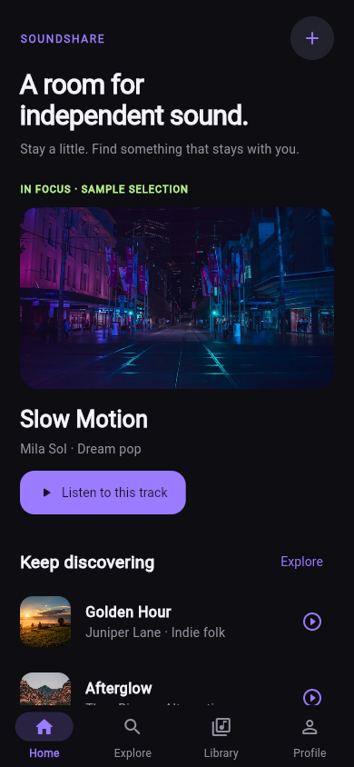
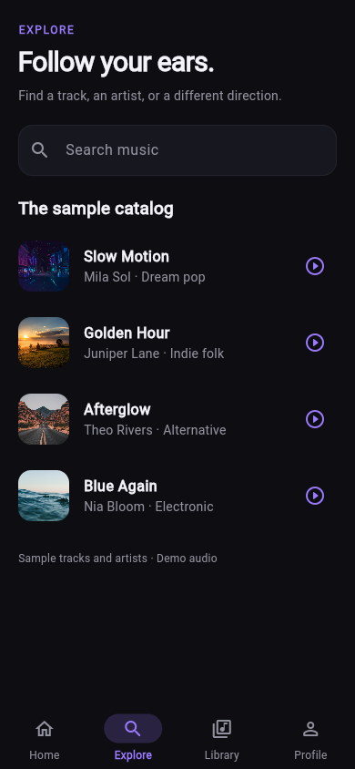
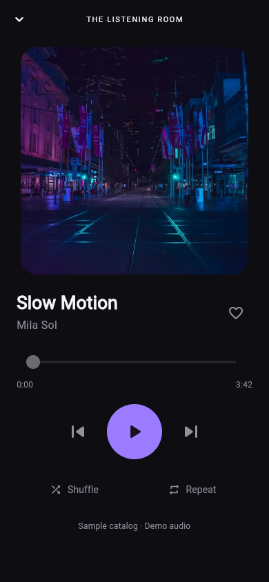
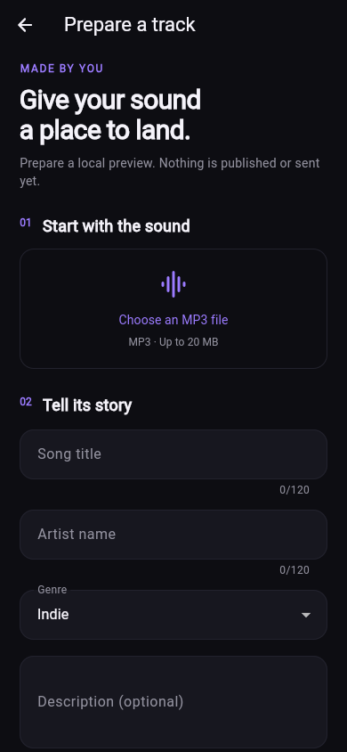
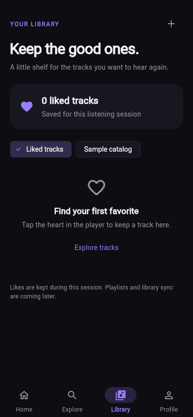
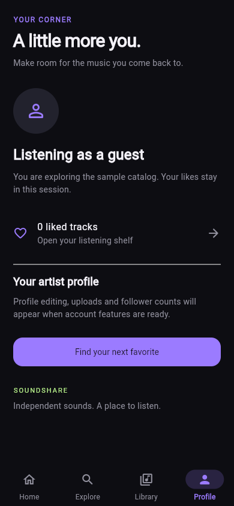

# Rà soát UI — issue #5

Ngày kiểm tra: 05/11/2026. Áp dụng [Taste Skill cho Flutter](../../.agents/skills/design-taste-frontend/SKILL.md), theo mục tiêu và hướng thiết kế trong [DESIGN.md](../../DESIGN.md).

## Kết quả

| Kiểm tra | Kết quả |
|---|---|
| `dart format --output=none --set-exit-if-changed lib test` | Đạt sau khi format. |
| `flutter analyze --no-pub` | Không có vấn đề. |
| `flutter test --no-pub` | 30 test đạt, không có lỗi. |
| `flutter build web --release --no-pub --no-web-resources-cdn --no-wasm-dry-run` | Build thành công. |
| Rà soát hình ảnh | Home, Explore, Player, Upload, Library, Profile ở 320×640, 390×844, 430×932 trên Flutter Web/Chrome headless. |

Widget test kiểm tra cả sáu màn hình ở ba kích thước trên với cỡ chữ gấp đôi; tên bài/nghệ sĩ dài trên điện thoại hẹp; tìm kiếm khi bàn phím mở; nhãn và vùng chạm Android của Explore. Các luồng đã kiểm tra: tìm kiếm/xóa truy vấn, chọn đúng bài, chuyển bài theo vòng, shuffle/repeat, play/pause và giữ mini-player qua tab, like → Library/Profile, catalog loading/error/retry/empty, lỗi tải/phát audio bất đồng bộ, validation MP3, lỗi file picker, bản xem trước local và kết quả picker trả về sau khi rời màn hình. Các phụ thuộc được giả lập; không truy cập dịch vụ thật trong widget test.

Rà soát ảnh đã phát hiện icon tab đang chọn thiếu tương phản. Theme đã được sửa để icon và nhãn chọn cùng dùng tím; chip Library dùng tím và dấu chọn. Kết quả cuối giữ bố cục cuộn ở điện thoại hẹp, artwork làm điểm nhấn, nhóm điều khiển playback riêng và văn bản mô tả rõ phần mẫu.

## Ảnh chụp sau thay đổi

Các ảnh dưới đây chụp ứng dụng Flutter Web được build từ source và phục vụ trên loopback, không phải bản thiết kế dựng lại. Không cấu hình Clerk trong bản chụp, nên Profile ở trạng thái khách. Player chưa bắt đầu phát. Upload đang ở trạng thái chưa chọn file; Library chưa có lượt thích.

| Home — 390×844 | Explore — 390×844 |
|---|---|
|  |  |

| Player — 390×844 | Upload — 390×844 |
|---|---|
|  |  |

| Library — 390×844 | Profile — 390×844 |
|---|---|
|  |  |

Ảnh bổ sung: [Home 320×640](issue-5/home-320.png), [Player 320×640](issue-5/player-320.png), [Home 430×932](issue-5/home-430.png). Nội dung thấp hơn viewport của Upload và màn hình hẹp có thể cuộn; ảnh không thể hiện toàn bộ form.

## Phần mẫu và giới hạn xác minh

- Catalog có bốn bài/nghệ sĩ mẫu, artwork Unsplash có sẵn và một URL audio demo dùng chung. Không xác nhận quyền phát hành các nội dung này.
- Like là trạng thái trong bộ nhớ của phiên ứng dụng; chưa lưu vào tài khoản. Playlist, đồng bộ thư viện và chỉnh sửa hồ sơ chưa triển khai.
- Upload chỉ đọc file/metadata và tạo bản xem trước local; chưa gọi API media, chưa xuất bản hoặc lưu bản nháp. Kiểm tra client không thay thế validation server.
- Profile có nhánh dùng danh tính Clerk, nhưng lần kiểm tra này chưa xác minh bằng phiên Clerk thật.
- Chưa có Android/iOS emulator hoặc thiết bị thật. Screenshot Flutter Web và widget test không chứng minh native file picker, phát audio thật, lifecycle/background playback, TalkBack/VoiceOver hoặc hiệu năng trên thiết bị đã được kiểm tra.
- Không chạy các script inspector website upstream của Taste Skill trên Flutter native. Đây là review bằng ảnh chụp Flutter Web và công cụ kiểm thử Flutter.
