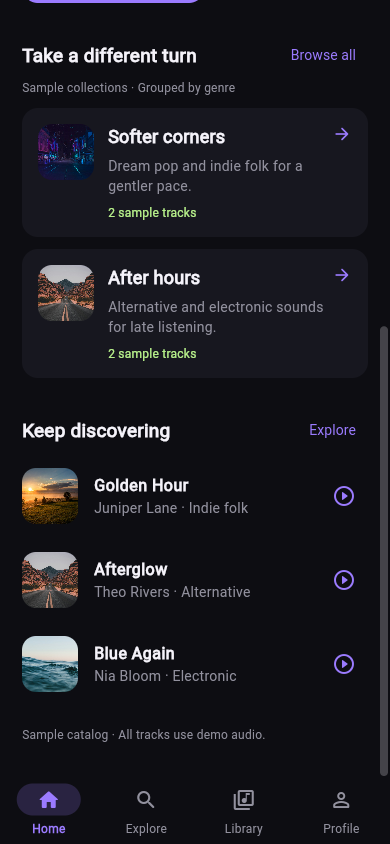
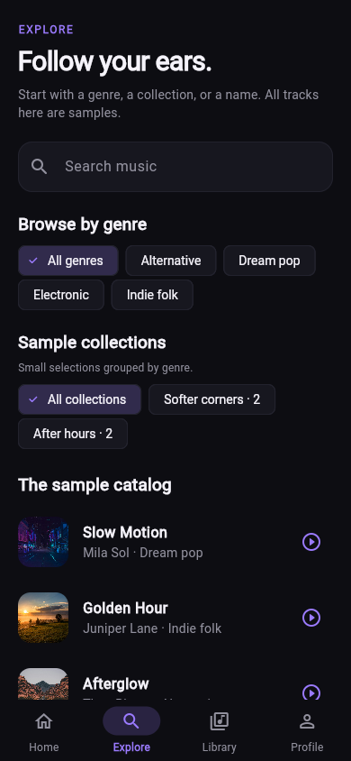
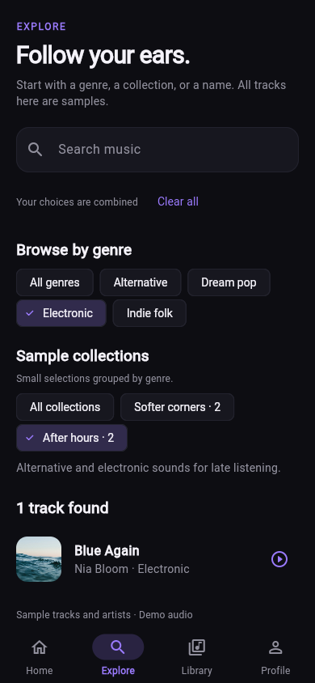
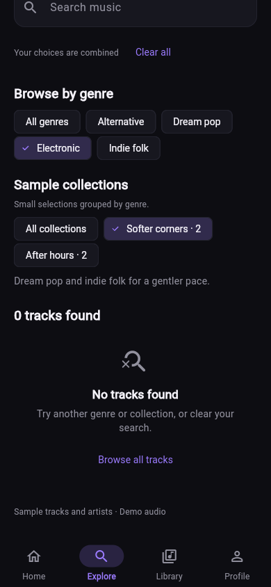

# Rà soát khám phá Home/Explore — issue #7

Áp dụng [Taste Skill cho Flutter](../../.agents/skills/design-taste-frontend/SKILL.md) và [hướng thiết kế](../../DESIGN.md). Ngày kiểm tra: 05/11/2026, Flutter 3.47.4 / Dart 3.13.3.

## Hành vi

Home giữ bài nổi bật và thêm hai bộ sưu tập mẫu có artwork hiện có, mô tả và số bài. Explore cho chọn thể loại từ catalog, chọn một bộ sưu tập và nhập từ khóa; kết quả khớp tất cả lựa chọn. Tất cả nội dung vẫn ghi nhãn sample/demo.

Chip có dấu chọn và selected semantics. Có thể bỏ riêng thể loại, bộ sưu tập hoặc từ khóa; Clear all đưa về trang duyệt mặc định, đóng bàn phím và cuộn về đầu. Route lưu lựa chọn nên mở từ Home/link và quay lại từ Player giữ đúng danh sách; lọc không làm thay đổi index bài phát. Số bài cạnh mỗi bộ sưu tập lấy từ toàn catalog, không giả định dữ liệu cá nhân hóa.

## Kiểm chứng

| Kiểm tra | Kết quả |
|---|---|
| `dart format --output=none --set-exit-if-changed lib test` | Đạt. |
| `flutter analyze --no-pub` | Không có vấn đề. |
| `flutter test --no-pub` | 49 test đạt: 30 test hiện có và 19 test khám phá mới. |
| `flutter build web --release --no-pub --no-web-resources-cdn --no-wasm-dry-run` | Thành công. |
| Rà soát ảnh Flutter Web | Home/Explore mặc định, bộ lọc đang chọn và không có kết quả ở 320×640, 390×844, 430×932. |

Test mới kiểm tra giao của từ khóa/thể loại/bộ sưu tập, chuẩn hóa thể loại, link chứa ký tự đặc biệt, mở bộ sưu tập từ Home, phát đúng bài và quay lại giữ bộ lọc, xóa từng nhóm và xóa hết, giữ focus khi sửa ô tìm kiếm, trạng thái catalog loading/error/retry/empty, bộ sưu tập trống/link không hợp lệ, chip selected semantics và vùng chạm/nhãn trợ năng. Test cỡ chữ 2× có cả thể loại dài ở ba kích thước điện thoại; các test playback/upload hiện có tiếp tục đạt. Audio player/catalog/file picker được giả lập, không gọi dịch vụ thật.

Kiểm thử phát hiện heading có action bị tràn khi cỡ chữ 2× trên 320 px. `SectionHeading` chuyển action xuống dưới ở màn hình hẹp hoặc chữ lớn. Kiểm thử quay lại từ Player cũng dẫn đến bổ sung cuộn về đầu khi Clear all, để nhìn thấy ngay từ khóa đã được xóa.

## Ảnh sau thay đổi

Ảnh chụp ứng dụng Flutter Web release phục vụ trên loopback, ở cỡ chữ mặc định; Home đã cuộn tới phần mới, trạng thái không kết quả đã cuộn để thấy thông báo và hành động phục hồi. Cỡ chữ 2×, catalog trống và lỗi dữ liệu được kiểm tra bằng widget test.

| Home — bộ sưu tập mẫu, 390×844 | Explore — mặc định, 390×844 |
|---|---|
|  |  |

| Explore — đang lọc, 390×844 | Explore — không kết quả, 390×844 |
|---|---|
|  |  |

Ảnh bổ sung: [Home 320×640](issue-7/home-collections-320.png), [Explore 320×640](issue-7/explore-320.png), [Explore 430×932](issue-7/explore-430.png). Trang có thể cuộn để tới các kết quả/nội dung thấp hơn viewport.

## Giới hạn

- Catalog vẫn là bốn bài/nghệ sĩ mẫu, artwork Unsplash có sẵn và một nguồn audio demo dùng chung. Hai bộ sưu tập chỉ nhóm theo thể loại đã khai báo, chưa có cá nhân hóa, API catalog, persistence hoặc dữ liệu recommendation thật.
- Không thay đổi backend/schema, authentication hoặc API media. Không xác minh phiên Clerk hay upload/cloud playback thật trong lần kiểm tra này.
- Chưa có Android/iOS emulator hoặc thiết bị thật. Widget test/Flutter Web không thay thế kiểm tra native audio, lifecycle, TalkBack/VoiceOver hoặc hiệu năng thiết bị.
- Không chạy browser inspector upstream của Taste Skill trên Flutter native.
