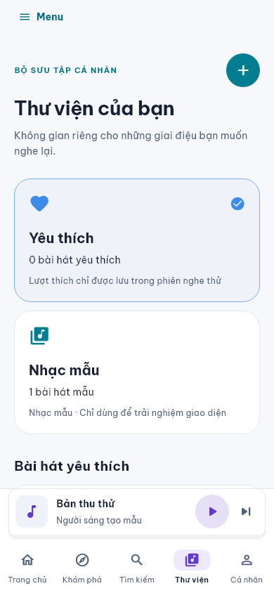
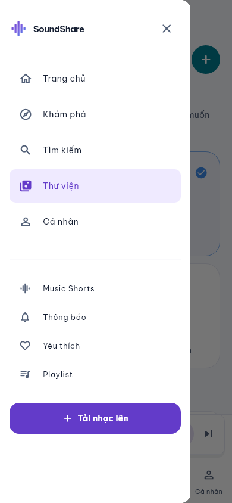
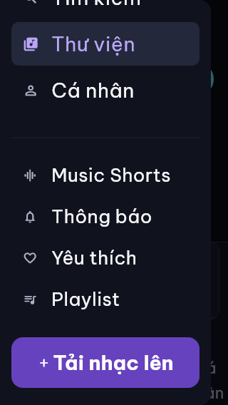

# Menu điện thoại và nút Đăng nhập — 08/11/2026

Trước thay đổi, điện thoại chỉ có năm tab chính; các liên kết bổ sung nằm trong sidebar dành cho màn hình từ 768 px. Nút Đăng nhập trên trang chào Web có mũi tên trang trí.

Điện thoại giữ năm tab và thêm nút **Menu** ở đầu nội dung, luôn có thể mở dù trang đã cuộn. Drawer dùng chung danh sách với sidebar: năm mục chính, Music Shorts, Thông báo, Yêu thích, Playlist và Tải nhạc. Drawer có Safe Area, cuộn dọc, nút đóng và đóng khi chọn trang hoặc nhấn Back. Thêm liên kết Thông báo cho sidebar/rail và đánh dấu mục phụ đang chọn. Trang tùy chọn thông báo giữ nút Quay lại riêng để AppBar không tự thay bằng nút mở drawer.

Nút Đăng nhập ở `web/auth.html` chỉ giữ chữ; luồng Clerk, đăng ký và chuyển trang tiếp tục dùng các handler hiện có. Không thay backend, API, schema, dependency, phiên đăng nhập hoặc audio engine.

## Kiểm tra giao diện

Ảnh dưới chụp từ Flutter widget tests, dùng font và icon của ứng dụng, dữ liệu mẫu nhỏ ghi rõ “Bản thu thử / Người sáng tạo mẫu”; không dùng tài khoản hoặc nhạc thật. Chưa nghiệm thu Safari trên thiết bị vật lý và chưa deploy bản UI này lên Render.

| Kích thước | Giao diện / cỡ chữ | Kết quả |
|---|---|---|
| 320 × 568 | Tối, chữ 200% | Cuộn tới các mục cuối và bấm Tải nhạc được |
| 390 × 844 | Sáng, chữ 100% | Menu đầy đủ, trạng thái chọn rõ, năm tab dưới giữ nguyên |
| 640 × 360 | Tối, chữ 200% | Chế độ ngang thấp vẫn cuộn và chọn được mọi mục |

Test xác minh từng mục có thể bấm, chọn tab chính, đóng bằng Back, mở trang upload và giữ nguyên nguồn audio/bài đã chọn mà không tải lại. Bộ hồi quy mobile/social xác minh thêm nút Quay lại trong tùy chọn thông báo và thư viện rỗng sau khi cuộn.

Kiểm tra: `flutter analyze` sạch; `flutter test --no-pub` qua 321 test; `node --test test/web/*.cjs` qua 25 test; `git diff --check` sạch. Build Web release với `--no-web-resources-cdn` và cấu hình công khai thành công (207,5 giây). Bản HTML được Express local phục vụ trả 200 và liên kết Đăng nhập chỉ có text. Ảnh được tạo lại bằng `flutter test test/mobile_navigation_test.dart --dart-define=CAPTURE_UI=true`; các kiểm tra này dùng fixture, không đăng nhập hoặc ghi dữ liệu vào dịch vụ thật.

